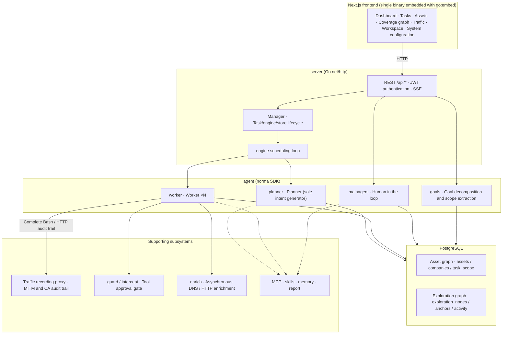
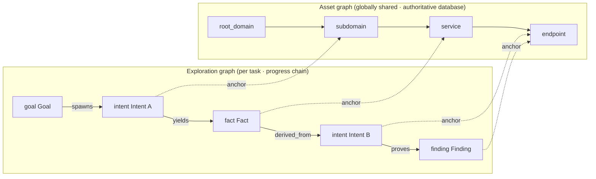
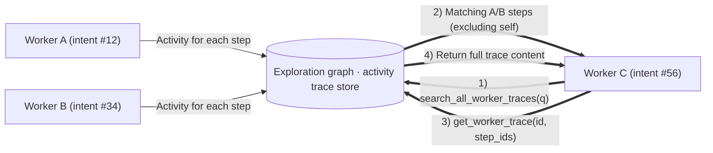
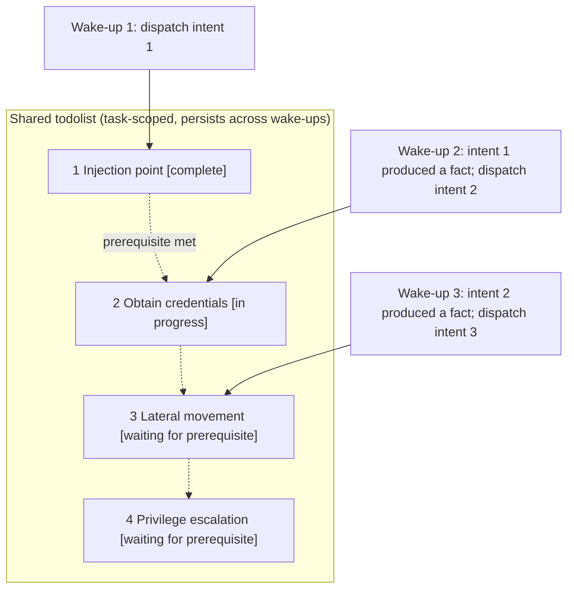

<div align="center">

# ARTEX

AI autonomous penetration testing system (Go backend + Next.js frontend)

Translated to English by Error336070 - Credit goes to Original Developer @Autumn-27

🌐 **Online demo (simulated data)**： [https://artex-demo.mhtsec.com](https://artex-demo.mhtsec.com)

📦 **This repository is a source-only backup of the final ARTEX version. Docker Compose builds ARTEX from the current checkout by default and does not pull a remote ARTEX image.**

</div>

---

## Screenshot preview

> See the [online demo](https://artex-demo.mhtsec.com) for full interaction (frontend and mock data only; no backend required).

| Dashboard (overview / token usage / activity stream) | Task list |
| :---: | :---: |
|  |  |

| Task execution (sessions / tool calls) | Exploration graph |
| :---: | :---: |
|  |  |

| Findings | Assets |
| :---: | :---: |
|  |  |

| Asset coverage graph (force-directed layout, tested assets highlighted, collapsible nodes) |
| :---: |
|  |

| Traffic recording | Human-in-the-loop chat |
| :---: | :---: |
|  |  |

| Agent management | LLM configuration |
| :---: | :---: |
|  |  |

| Interception approvals | Backend logs |
| :---: | :---: |
|  |  |


---

## Approval record details

Global approval records, task interception approvals and chat approval cards can all expand to show details. The layout references
[AegisHook's approval details component](https://github.com/RuoJi6/AegisHook/blob/main/web/src/components/CallDetail.vue), using ARTEX components and theme:


## Asset synchronization (ScopeSentry)

Synchronize asset data directly from [ScopeSentry](https://github.com/Autumn-27/ScopeSentry) to avoid duplicate collection:

- Connect a data source by entering the ScopeSentry address and API key on the **Asset synchronization** page;
- Select targets and asset types by **project** or **task** (domains / subdomains / IPs / ports / sites / endpoints...);
- Import and merge by company asset scope directly into the ARTEX asset graph for agent exploration.

---

## Installation

> Requires **PostgreSQL**; exploration requires an **LLM** (`ANTHROPIC_API_KEY` or `OPENAI_API_KEY`, also configurable in the UI).

### Method 1: installation script (recommended)

```bash
git clone https://github.com/Error336070/ARTEX.git
cd ARTEX
./install.sh
```

The script detects or installs Docker, then offers **1. All Docker** or **2. Build and run locally**:

- **1. All Docker**: enter a Postgres password (Enter for random) → generate `.env` and a setup token → build the image from current source and start.
- **2. Local**: select a database (existing or Docker) → generate `config.json` → build a single binary with embedded frontend using `go` → generate a setup token and start.

After installation, open **http://localhost:8787**. At the first visit to `/setup`, enter the setup token displayed by the installer, then set the administrator password. The token is only for initial setup; do not share it with other users.

### Method 2: Docker Compose (manual)

```bash
git clone https://github.com/Error336070/ARTEX.git
cd ARTEX
cp .env.example .env          # Set POSTGRES_PASSWORD and optionally ANTHROPIC_API_KEY
# Generate a token with openssl rand -hex 32 and set ARTEX_SETUP_TOKEN in .env (without quotes)
chmod 600 .env
docker compose up --build -d  # Build ARTEX from current source; Postgres still uses the official image
# → http://localhost:8787
```

> The ARTEX Compose service has only a local build configuration; `pull_policy: build` ensures even `docker compose up -d` builds from current source.
> If the current shell sets `ARTEX_SETUP_TOKEN`, Compose gives it precedence; during manual deployment, ensure it matches the token in `.env`.
> Dockerfile uses a multistage build (static frontend export → static Go compilation → runtime image), with dependency mirrors suitable for China by default. Override using `--build-arg GOPROXY=... / --build-arg NPM_REGISTRY=...`.

The image includes common tools (ripgrep/curl/vim/npm/nmap...); bind mounts persist `./skills` and `./data`.

For remote MCP, select `http` (Streamable HTTP) or `sse` (legacy SSE) in System settings.
Legacy SSE services usually establish the event stream with `GET /sse`, then receive JSON-RPC requests through the returned
`/message?sessionId=...` endpoint. Configure the URL as `/sse` and enter the request header as
`Authorization=Bearer <token>`.

### Method 3: prebuilt binaries

Older release binaries lack the initial setup token validation in this source. Do not use them to start uninitialized instances; build from current source using Method 4. Start the resulting program with `start.sh` or `start.bat`; the supervisor script restarts it after UI updates.

### Method 4: build a single binary from source

```bash
# 1) Static frontend export
cd web && npm ci && npm run build:static && cd ..
# 2) Copy into the embedded directory
cp -r web/out server/webui/dist
# 3) Build (-tags embedui embeds the frontend)
CGO_ENABLED=0 go build -tags embedui -o artex ./cmd/artex
openssl rand -hex 32 > .setup-token  # Initial setup token; generate only once here
chmod 600 .setup-token
cat .setup-token                     # Copy the token and enter it on the first visit to /setup
./start.sh
```

### Method 5: build cross-platform release archives

`build.sh` builds and embeds the frontend, strips debugging information with the Go linker, then packages release files as ZIP archives. Release mode defaults to Linux amd64/arm64, macOS amd64/arm64, and Windows amd64:

```bash
./build.sh --release
# Output:dist/artex-0.3.3-*.zip
```

UPX self-extracting binaries may be incompatible with some Linux kernels, virtualization environments or security policies, so UPX is disabled by default. Customize targets with `ARTEX_TARGETS`; after confirming compatibility, pass `--upx` explicitly for a smaller binary:

```bash
ARTEX_TARGETS=linux/amd64,windows/amd64 ./build.sh --release
./build.sh --target linux/amd64 --upx
```

---

## Updates and upgrades

> Upgrades replace the program and preserve data: Postgres volume `pgdata`, `./data` (jwt.key / SQLite, etc.) and `./skills`. **No manual database migration is required**: `artex` reruns `schema.sql` idempotently on each start (including `ADD COLUMN` / `CREATE INDEX IF NOT EXISTS`), so restarting performs migration. Back up `./data` and the database before upgrading.

### Method 1: update from the UI (recommended)

Check and install new versions in the **Version and updates** card on **System configuration** (sidebar → `/system/settings`), without logging into the server.

Click Update: download the release for the current platform → verify against release `SHA256SUMS` → smoke-test the new binary with `-h` → stage as `artex.new` → exit and let `start.sh` / `start.bat` restart and apply replacement. The page waits for the new version and refreshes automatically.

- **Failure does not install a broken program**: failed verification or smoke testing discards the staged binary and keeps the current version. Three consecutive startup failures after replacement trigger automatic rollback to `artex.old` (the failed binary is retained as `artex.failed` for diagnosis).
- **Rollback is available**: the previous version remains as `artex.old`; select Roll back to previous version in the card. Database schema changes are not rolled back.
- **Updates interrupt running tasks** by restarting the service. Update while idle.
- **Development builds disable updates** when the version is `dev` or `git describe` has a suffix, protecting locally built debugging binaries from release replacement.
- **Docker updates replace only the program**: image tools such as playwright / nmap are not upgraded, and rebuilding a container restores the image's bundled version. To upgrade the image too, update source and run `docker compose up --build -d artex`.
- If GitHub requires a proxy, configure the **Global proxy** on the same page; updates use it. Downloads are restricted to GitHub domains and require HTTPS.

### Method 2: update script

```bash
cd ARTEX
./update.sh
```

The script optionally pulls the latest code with `git pull`, then offers **1. Docker update** or **2. Local build update** (matching `install.sh`):

- **1. Docker**: optionally fast-forward source, then rebuild the image and start (automatic migration on restart).
- **2. Local**: rebuild static frontend output → rebuild `./artex` (restart the process afterwards to apply).

### Method 3: Docker Compose (manual)

```bash
cd ARTEX
git pull --ff-only             # Update to the source version to run
docker compose up --build -d artex  # Build this version and restart → automatic schema migration
docker image prune -f          # Remove old images (optional)
```

### Method 4: prebuilt binaries (Releases)

If this fork has a compatible package on its [Releases page](https://github.com/Error336070/ARTEX/releases), download that ZIP, stop the old process, replace `artex` and `skills/` (preserve your `config.json` and `data/`), then restart. Otherwise, build from source using Method 5:

```bash
cp -r <extracted-directory>/skills ./ && cp <extracted-directory>/artex ./
./start.sh
```

### Method 5: build from source

```bash
git pull
cd web && npm ci && npm run build:static && cd ..
cp -r web/out server/webui/dist
CGO_ENABLED=0 go build -tags embedui -o artex ./cmd/artex
# Restart ./start.sh
```

---

## Configuration

**Database** (`config.json`, overridden by environment variable `ARTEX_PG_DSN`):

```json
{
  "database": {
    "host": "127.0.0.1", "port": 5432,
    "user": "artex", "password": "yourpass",
    "dbname": "artex", "sslmode": "disable"
  }
}
```

**LLM**: `export ANTHROPIC_API_KEY=sk-...` (or `OPENAI_API_KEY`), or enter it on the UI's LLM configuration page.
Optional: `ARTEX_LLM_PROVIDER` / `ARTEX_LLM_MODEL` / `ARTEX_LLM_BASE_URL` / `ARTEX_LLM_PROXY`.

**Initial setup**: the server requires `ARTEX_SETUP_TOKEN` to contain at least 32 characters. The installer generates and displays it; local installation also saves it in `.setup-token` with mode 600 for `start.sh` or `start.bat` to read on restart. For manual startup, set the environment variable first, then enter the same token at `/setup`. With a missing or incorrect token, `POST /api/auth/init` neither sets a password nor issues a token. Instances with an administrator password already set reject reinitialization.

**Concurrency**: configure Workers per task in System settings (default 3).

**Common arguments**: `./start.sh -addr :8787 -proxy :8788` (`-addr` for frontend/API, `-proxy` for the traffic recording proxy). The launcher passes arguments unchanged to `artex`.

### Reverse proxy deployment (HTTPS / expose only 443)

The frontend and API/SSE share one backend port (default `:8787`). Live activity uses **same-origin** URLs by default, so **`NEXT_PUBLIC_SSE_BASE` is unnecessary**. Expose only 443 publicly and keep 8787 internal.

SSE uses a persistent connection with continuous updates. Reverse proxies **must disable buffering**, or the browser connects but receives no events (the activity stream keeps spinning). Nginx example:

```nginx
server {
    listen 443 ssl;
    server_name your.domain.com;
    # ssl_certificate / ssl_certificate_key ...

    location / {
        proxy_pass http://127.0.0.1:8787;
        proxy_set_header Host $host;
        proxy_set_header X-Forwarded-Proto $scheme;

        # SSE requirements: no buffering, long timeout, HTTP/1.1
        proxy_buffering off;
        proxy_cache off;
        proxy_read_timeout 3600s;
        proxy_http_version 1.1;
        proxy_set_header Connection "";
    }
}
```

> Set `NEXT_PUBLIC_SSE_BASE` **at build time** only when SSE uses a different origin from the page (such as a separate subdomain). `next build` embeds this variable in the static bundle; setting it at container runtime has no effect.

---


## Development

### Manual finding retests

The Retest tab in task details supports paginated finding selection, previous conclusions and evidence, and manual retest requests. Starting a retest keeps the current tab open and displays a spinner with Retesting; confirmed remediation updates the finding status.

Click Retest in a finding row, or Start retest in the Finding retest section of its details. Optionally enter the fixed version, test conditions or limits. The system creates a separate retest agent session and keeps the current page open. Flat, task-grouped and asset views all support this action. While running, it shows a spinner and Retesting; click to open the session. Afterwards it returns to Retest. Retesting does not restart the original scan task. Conclusions are Still reproducible, Fixed or Inconclusive; each conclusion, evidence and session link is saved in finding details.

The updated backend seeds an editable Finding retest (`retester`) agent on first start. Configure prompts, LLM, runtime budget and tools in Agent management. It uses its bound LLM, falling back to the globally active profile if unbound. A successfully completed retest with a Fixed conclusion automatically sets the finding's remediation status to Fixed; running, failed, stopped or other conclusions preserve the original status. Original evidence and reports remain available. Fixed can also be selected manually in the status menu. An active retest for the same finding reuses its session; stopped, failed or service-restarted sessions can be started again.

This version exposes history through finding details and sessions; it is not yet included in finding report exports or task archives, and traffic records are not linked automatically. Demo mode only generates clearly labelled simulated records and makes no requests to real targets.

### Local development and tests

```bash
./dev.sh    # Backend (:8787) + traffic proxy (:8788) + next dev frontend (:5173) → http://localhost:5173
```

- Backend: `go run ./cmd/artex` (without `-tags embedui`, the frontend is not embedded)
- Frontend: `cd web && npm run dev` (`/api` proxies to the backend; hot reload enabled)
- Tests: `go test ./...`
- Mock preview (no backend):`cd web && NEXT_PUBLIC_MOCK=1 npm run dev`
- Redeploy the online demo (Cloudflare Pages, static export and mock data):
  ```bash
  cd web && NEXT_PUBLIC_MOCK=1 npm run build:static
  CLOUDFLARE_API_TOKEN=<token> npx wrangler pages deploy out --project-name=artex-demo --branch=main
  ```

---

## System architecture

ARTEX is an **LLM-driven autonomous penetration testing system with multiple agents**: a monolithic Go backend with embedded Next.js frontend and PostgreSQL. The [`norma`](https://github.com/Autumn-27/norma) SDK supplies agent capabilities (`agentcore` / `tool` / `permission` / `harness` / `memory` / `transcript`). Its core is a **dual-graph architecture** with two autonomy mechanisms: **execution-trace information sharing among Workers** and **a Planner checklist shared across turns to coordinate attack chains**.

### System layers



| Layer | Responsibility |
| --- | --- |
| **Frontend** | Next.js static export embedded in a single binary with `go:embed`; task/asset/exploration/coverage visualization and human-in-the-loop chat |
| **server** | `net/http` routing, JWT authentication and SSE; `Manager` owns task, engine and DB store lifecycles |
| **engine** | One `plannerLoop` and N Worker goroutines per task; intent claiming, timeout/pause/drain |
| **agent** | goals / planner / worker / mainagent; `ToolSet` exposes both graphs as LLM tools |
| **db** | Postgres persistence for both graphs (pgx); schema embedded with `go:embed` creates tables idempotently on startup |
| **Support** | Recording MITM proxy, approval gate, asynchronous enrichment, MCP/skills/memory/reports |

### Dual-graph architecture: exploration graph and asset graph

The system represents **what the target is** and **how thoroughly it has been assessed** in two independent graphs connected by anchors:

- **Asset graph (globally shared)**: one authoritative asset database across tasks. Nodes are `root_domain / subdomain / ip / service / app / endpoint`, owned by companies. Code computes domain→subdomain→service→endpoint parent relationships and deduplication keys; agents submit raw information only.
- **Exploration graph (per task)**: a task's reasoning and progress. Nodes are `goal / intent / fact / finding / hint`; edges such as `spawns / derived_from / yields / proves` form a **provenance chain** showing which direction arose from which facts and what it produced.
- **Anchors connect both graphs**: `exploration_anchors(node_id, asset_id)` links intents/facts/findings to specific assets. An exploration direction identifies its assets; an asset identifies the intents that assessed it and the facts produced within the task. This also supports **asset test coverage** and the **asset coverage graph** (in-scope assets with tested assets highlighted).



> Responsibilities: the **Planner** reads the exploration graph, evaluates goals, and adds **intents** to the frontier only for new, uncovered directions. A **Worker** claims **one intent**, executes tools, records new assets/facts/findings in both graphs, then stops. The asset graph stores shared facts; the exploration graph tracks each task's progress.

### Engine and intent lifecycle (one exploration cycle)

The engine uses an **event-driven** cycle: graph changes wake the Planner, which creates intents; Workers claim them, execute and write results back. Those writes trigger the next turn, until the goal is proven (`prove_goal`).

```mermaid
sequenceDiagram
  autonumber
  participant EV as Debounced graph changes
  participant P as planner
  participant FR as frontier intent queue
  participant W as worker
  participant PX as Recording proxy
  participant DB as Both graphs + activity

  EV-->>P: Wake
  P->>DB: Read state (prefetched graph_overview + coverage/scope)
  P->>FR: Create 0..N intents (with asset_ids)
  Note over P,FR: Most turns create 0 intents; no new direction ends the turn
  W->>FR: claimNext claims one intent
  W->>DB: Load raw assets for intent asset_ids as initial context
  W->>PX: Execute real tools (Kali / Bash / HTTP)
  PX-->>W: Response (complete audit trail + CA verification)
  W->>DB: Write fact / asset / finding + activity for each step
  DB-->>EV: Graph change
  EV-->>P: Wake again (cycle)
```

### Execution-trace information sharing among Workers

Useful observations during exploration (an error, a response excerpt or an undocumented parameter) may appear in a Worker's **execution trace** without becoming a formal fact. Workers can **search traces across work sessions** to avoid duplicate effort and share observations:

- `search_all_worker_traces(q)` searches **other work sessions' execution traces within this task** by keyword, automatically excluding the current intent's steps; matches include `intent_id`;
- `list_worker_traces` / `get_worker_trace(intent_id, step_ids=[…])` lists completed work sessions, then retrieves full content for selected steps to share details.

Later Workers can reuse observations even before a corresponding fact exists in the exploration graph. **Workers share information at execution-trace granularity**, while each Worker remains limited to its claimed intent.



### Planner checklist shared across turns → stable attack chains

Real attack chains are often **multi-step sequences with prerequisites** (for example, finding an injection point → obtaining credentials → moving laterally → escalating privileges). Dispatching every step in parallel would break that order. The planner therefore maintains a **task-scoped checklist (todolist) shared across wake-ups**:

- The planner is event-driven and wakes when the graph changes, but **each wake-up starts a new session**. The shared todolist records a sequential chain **once**, then dispatches intents according to their dependencies over later rounds, instead of expanding the whole chain up front in one round.
- Each turn creates an intent only for the next step whose prerequisites are complete and whose required facts exist. It updates the checklist as progress is made, marking steps complete when facts satisfy them.



This lets the chain **advance consistently, without duplication or ordering errors**, despite event-driven scheduling and stateless sessions. That is how ARTEX can complete a multi-step chain autonomously.

---

## Community

Scan the QR code to follow the **SecSentry** WeChat public account, then send it a private message to join the community group.

<div align="center">


</div>

---
## References

https://github.com/oritera/Cairn


## License and disclaimer

### Open-source license

This project is licensed under the **GNU Affero General Public License v3.0 (AGPL-3.0)**. Full terms are in the repository root [LICENSE](LICENSE) file.

Anyone may use, modify and distribute the project, but **derivative works must also be open source under AGPL-3.0**. In particular, **if you modify the project and provide it to users over a network (for example as an online service), you must make the corresponding complete source code available to those users**.

> ⚠️ **Important**: the open-source license itself does not restrict purposes of use. The following usage restrictions and disclaimer are additional conditions and statements from the author to users; please observe them.

**ARTEX is solely for personal learning, source code research and local technical validation. It must not be used for actual testing of any online system or website.**

### Permitted use

- Only **reading, learning and researching this project's source code**, and validating technical principles in **locally isolated environments**, are permitted;
- Suitable for personal learning, academic research, code review and other non-offensive purposes.

### Prohibited use

- **Using this tool to scan, probe, exploit or attack any website, online service or network-connected system is strictly prohibited**, regardless of authorization or asset ownership;
- Use for actual penetration testing, attack/defence exercises or production environments is strictly prohibited;
- Use for illegal intrusion, data theft, extortion, denial of service, or any destructive or criminal activity is strictly prohibited;
- Use that violates the laws or regulations of your country or region is strictly prohibited.

### Compliance responsibility

Users must comply with all cybersecurity, data protection and computer crime laws and regulations in their country or region (in mainland China, including but not limited to the Cybersecurity Law, Data Security Law, Personal Information Protection Law and relevant judicial interpretations). **Users bear all legal responsibility and consequences arising from use of this tool.**

### Disclaimer

This project is provided **AS IS**, without any express or implied warranty. The author and contributors accept no responsibility for direct or indirect losses, data loss, system damage or legal disputes resulting from use of this tool, whether used appropriately or otherwise. **By downloading, installing or using this project, you acknowledge that you have read, understood and agreed to all terms above.**
