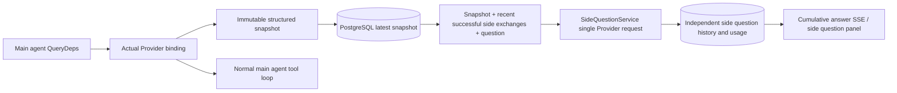

# ARTEX `/btw`

Ordinary conversations, task MainAgent sessions, and the current task's own Workers support independent side questions. Enter `/btw question` in the main input to submit one; an empty `/btw` or the Side question button opens history. Desktop uses a resizable sidebar; mobile uses a Drawer.

Answers use the agent context snapshot selected at submission and support streaming, follow-up questions, stopping, and clearing. Closing the panel, refreshing, or disconnecting SSE does not cancel the model request. Stop affects only the current side question; Clear cancels it and deletes side question history while retaining the main context snapshot.

## Implementation boundaries

Uses Go, norma v0.3.7, Next.js, and existing Markdown / ResizablePanel / Drawer / AlertDialog components. No norma source changes or additional side question dependencies. Planner, Workers inherited from other tasks, and upgrading tool subtasks are outside this scope.

- `capture.go` marks main-loop requests only in `Options.Deps.CallModel / CallModelSync`. The Provider decorator sits inside the concrete model, after the outer routing pool selects it, recording the actual selected model. Compression and summary requests do not overwrite the snapshot.
- Snapshots are published at request start, after a complete model reply, and at the terminal run state. Partial streamed replies are not published. norma's `MessagesForAPI` preserves tool call/result pairing; results enter the snapshot at the next main model request or terminal state. Interrupted streams retain the previous valid boundary.
- JSON deep copies preserve structured messages, system prompts, tool definitions, and generation parameters. Model inference holds no snapshot lock or database transaction.
- `SideQuestionService` calls the concrete Provider and prepares summaries when needed. The final answer may retry once with reduced context only after an initial overflow before any text or tool call is emitted. It creates no agent session and connects to no tool executor, main transcript, activity stream, task graph, or task model failover chain. Answer requests retain tool definitions for compatibility with existing structured tool context; summary requests provide no tools. Newly returned tool calls have no execution path.
- One running request per parent session, at most four per service process, with a 120-second timeout. Side questions use an independent cancellation context under the service lifecycle.
- Requests retain a model profile reference and non-sensitive identity summary, obtaining credentials from the current configuration when called. Deleted profiles or changes to model/protocol/address identity require running the main agent first to refresh the snapshot. Tests do not change the product's default model.

## Persistence and recovery

`db/schema.sql` creates `side_question_sessions` and `side_question_requests`. The former stores the parent resource, latest snapshot, run ID, version, and clear generation; the latter stores the question, cumulative answer, status, model, snapshot timestamp, usage, event sequence, and pagination ordinal.

Parent keys use a conversation ID or task ID + exploration ID + intent ID. Workers are not named by reusable execution slots.

Snapshots are coalesced per parent and flushed every 250 ms; database comparison of `(run_id, version)` prevents older versions from overwriting newer ones. The selected snapshot is saved again before admission. Large in-memory snapshots are released after successful persistence; failed writes retain the pending version. Streaming cumulative answers are written at most every 250 ms. Terminal states are saved immediately with bounded retries on database errors.

At startup, leftover `running` requests become `interrupted`, retaining persisted partial answers and usage without replay. The latest successfully saved context supports the next question. Older sessions with no snapshot require a main agent run; UI activity records are not used to reconstruct context.

Clear increments the clear generation and deletes requests; conditional updates prevent late callbacks from writing them back. Physical parent deletion uses foreign-key cascades. Worker soft deletion removes side question data in the same transaction and rejects late snapshots. Task archive blocks new requests, waits for the main flow to stop, cancels side questions, and waits for persistence. Archive format v3 also supports v1/v2 archives without side question tables.

History is retained in full, with ordinal cursor pagination of at most 20 records per page. Model requests replay at most the 20 most recent successful exchanges, further limited by token budget; older exchanges have an independent rolling summary. When main context exceeds the budget, only the old portion of the side copy is summarized, preserving recent structured tool calls and results. Summaries, preparation progress, and usage share side question concurrency, cancellation, and the 120-second timeout. See [Context budgets and source references](CONTEXT_BUDGET.md).

## HTTP contract

These paths form `{parent}` and use existing authentication and resource validation:

- `/api/conversations/{id}`
- `/api/tasks/{id}/chat`
- `/api/tasks/{id}/intents/{iid}`

| Request | Response and behavior |
| --- | --- |
| `GET {parent}/side-questions?before={ordinal}` | `items` newest first, independent `current` running state, `snapshot` metadata, `next_cursor`; cursor 0 means latest page / no next page |
| `POST {parent}/side-questions` | JSON `{ "question": "…", "client_request_id": "UUID" }`; a new request returns 202 and the request object; the same ID and question returns the existing object with 200 |
| `DELETE {parent}/side-questions` | Cancel and clear this parent session's side questions |
| `GET /api/side-questions/{requestID}/events` | `snapshot` SSE events; `id` is an increasing sequence and `data` is the complete cumulative request object; Clear emits `cleared` |
| `POST /api/side-questions/{requestID}/cancel` | Explicit cancellation; terminal state is available through history or SSE |

Questions are limited to 4000 characters. Missing snapshots, changed profiles, busy parents, and idempotency ID conflicts return 409; the global concurrency limit returns 429. Every SSE connection first sends cumulative state, independent of previously received text fragments. The frontend merges by request ID + sequence and discards old callbacks when switching parents or clearing.

## Validation and references

See [VALIDATION.md](VALIDATION.md) for automated checks, actual model use, and known limitations.

Independent requests reference [Grok CLI side-question.ts (pinned commit)](https://github.com/superagent-ai/grok-cli/blob/fb97af83f06dca873281d60168430f06c8de6324/src/utils/side-question.ts); execution isolation references [OpenCode (pinned commit)](https://github.com/anomalyco/opencode/tree/b3f1a96c6dd7adeb28b36dd11add1998fc84d67b). ARTEX uses norma structured messages rather than text assembled from frontend logs.
