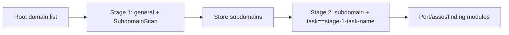

---

## name: scopesentry-mcp
description: Manage a security scanning platform through ScopeSentry MCP (projects, tasks, templates, assets and nodes). Use when the user mentions ScopeSentry, MCP, API keys, scan tasks or asset queries.

# ScopeSentry MCP guide

For users with an **existing ScopeSentry deployment**. Connect through Cursor or another MCP client; no local source checkout is required.

## 1. Preparation

### 1.1 Check service access

- Default Web UI: `http://<host>`
- MCP endpoint: `http://<host>/mcp` (use the actual `/mcp` address when a reverse or frontend proxy is present)

### 1.2 Create an API key

1. Sign in to the ScopeSentry Web UI.
2. Create a key on the **API Key** management page (or through an administrator-provided endpoint).
3. Save the returned `ssk_...` string (**shown only once**).

### 1.3 Configure Cursor MCP

Cursor → Settings → MCP → Add server:

```json
{
  "mcpServers": {
    "scopesentry": {
      "url": "http://<your-host>:8082/mcp",
      "headers": {
        "X-API-Key": "ssk_your-key"
      }
    }
  }
}
```

Alternatively, use `Authorization: Bearer ssk_your-key`.

Restart MCP or reload Cursor, then confirm tools such as `list_projects` and `list_assets` appear.

---

## 2. Tool overview

| Tool | Purpose |
| --- | --- |
| `list_projects` | Project tree grouped by tags, including project IDs |
| `list_projects_data` | Paginated project list with name search |
| `get_project` | Project details |
| `create_project` | Create a project |
| `list_tasks` | Scan task list |
| `get_task` | Task details |
| `list_scan_templates` | Scan template list |
| `get_scan_template` | Template details |
| `list_plugin_modules` | Scan pipeline module names |
| `list_plugins` | Available plugins, including hashes and default parameters |
| `create_scan_template` | Create a scan template |
| `create_scan_task` | Create a scan task |
| `list_assets` | Query asset types with pagination |
| `count_assets` | Count assets (`/api/assets/common/total`) |
| `get_asset_detail` | Asset or finding details |
| `add_asset_tag` | Add an asset tag |
| `list_nodes` | Scan node list |

Follow each MCP tool's schema for parameters. `list_assets` / `count_assets` share search and filter syntax; read the `list_assets` description before querying assets.

Use `count_assets` for a total (the Web pagination total endpoint), rather than paging through `list_assets` to count records.

---

## 3. Common workflows

### 3.1 Query assets by project

When the user or context **already identifies a project**, prefer `filter.project` to narrow results and avoid slow cross-project responses. Without a specific project, filtering is optional.

1. Obtain the target project's **ObjectID** (`id` / `children[].value`) with `list_projects` or `list_projects_data`.
2. Pass `filter.project` to `list_assets` (**use the ID, not the project's display name**).

```json
{
  "asset_type": "asset",
  "pageIndex": 1,
  "pageSize": 20,
  "search": "domain=^example.com",
  "filter": {
    "project": ["<project-ObjectID>"]
  }
}
```

### 3.2 Create a scan task

1. Use `list_nodes` to obtain online node names
2. Use `list_scan_templates` or `create_scan_template` to obtain a template **ObjectID**
3. `create_scan_task` requires `name` and `node`; set `template` to the template ID, not its name

**Target source `targetSource` (same as the Web UI):**

| targetSource | Description | Required parameters |
| --- | --- | --- |
| `general` | Enter targets directly | `target` |
| `project` | Read targets from a project | `project`(array of project ObjectIDs) |
| `asset` | Search the Web asset database | `search`; optional `project`, `filter`, `targetNumber` |
| `RootDomain` | Search the root domain database | `search`; optional `project`, `filter`, `targetNumber` |
| `subdomain` | Search the subdomain database | `search`; optional `project`, `filter`, `targetNumber` |
| `UrlScan` | Search URL scan results | `search`; optional `project`, `filter`, `targetNumber` |
| `*Source` (such as `subdomainSource`) | Create from selected/searched results on the Assets page | Use `search` for `targetTp=search`; use `targetIds` for `targetTp=select` |

**Example: scan root domains directly:**

```json
{
  "name": "example-subdomain-collection",
  "node": ["node-1"],
  "template": "<template-ObjectID>",
  "targetSource": "general",
  "target": "example.com\nfoo.com",
  "project": ["<project-ObjectID>"]
}
```

**Example: continue from the subdomain database, filtered by previous task name:**

```json
{
  "name": "example-ports-and-findings",
  "node": ["node-1"],
  "template": "<subsequent-module-template-ObjectID>",
  "targetSource": "subdomain",
  "search": "task==\"example-subdomain-collection\"",
  "project": ["<project-ObjectID>"]
}
```

### 3.3 Complete root domain inventory (two stages recommended)

For **root domain** input requiring a **complete inventory**, use two scans rather than running the whole pipeline at once.

**Reason:** distributed tasks are dispatched per **individual target**. When a node receives a root domain, its discovered subdomains also continue through subsequent modules on that node, which can cause uneven load, slow execution and errors.

**Recommended approach:**

1. **Stage 1: subdomain collection only**
   - `targetSource`: `general`
   - `target`: All root domains (multiple lines)
   - Template: Enable only `SubdomainScan` and `SubdomainSecurity` (subdomain scanning and subdomain takeover).
   - Wait for task completion with `get_task`

2. **Stage 2: subsequent modules**
   - `targetSource`: `subdomain`
   - `search`: `task=="<stage-1-task-name>"`(exact task-name match)
   - Optionally narrow the scope with `project`
   - Template: port scanning, asset mapping, vulnerability scanning, etc. (SubdomainScan may be omitted)
   - Dispatch subdomains to nodes as independent targets for better parallel efficiency

Alternatively, filter the Web UI's Subdomains asset page by task name and select Create task from subdomains for the same result.



### 3.4 Create a scan template

1. `list_plugin_modules` → module name list
2. `list_plugins` (optional `module` filter) → each plugin's `hash` and default `parameter`
3. `create_scan_template`: use `modules` to specify module → array of plugin hashes

---

## 4. Asset queries (`list_assets` / `count_assets`)

`count_assets` accepts the same `asset_type`, `search` and `filter` as `list_assets`. It returns `{ "total": N }`, corresponding to the Web endpoint `/api/assets/common/total`.

```json
{
  "asset_type": "subdomain",
  "search": "task==\"a-task-name\"",
  "filter": {"project": ["<project-ObjectID>"]}
}
```

**Performance (`list_assets` / `count_assets`):** when project context exists, narrow results with `filter.project`. Prefer exact `==` or prefix `^` matches on indexed fields in `search` (see [4.3](#43-search-expressions)); broad `=` searches can be slow. Without project context, a project filter is optional. See [4.4](#44-exact-filters) for asset types supporting `filter.project`.

### 4.1 Asset types `asset_type`

`asset`, `RootDomain`, `subdomain`, `app`, `mp`, `UrlScan`, `SensitiveResult`, `DirScanResult`, `crawler`, `vulnerability`, `PageMonitoring`, `IPAsset`, `SubdomainTakerResult`

Aliases: `web`→asset, `vuln`→vulnerability, `ip`→IPAsset, `url`→UrlScan.

### 4.2 Parameters

| Parameter | Description |
| --- | --- |
| `pageIndex` / `pageSize` | Pagination; defaults 1 / 20 |
| `search` | Search expression (next section) |
| `filter` | Exact filter JSON (below) |
| `sort` | Sorting by `length`, only for UrlScan and DirScanResult |
| `sid` | Sensitive rule name; SensitiveResult only |

`search` and `filter` **may be combined**.

### 4.3 Search expressions

Custom DSL (**not SQL**):

| Operator | Meaning | Index | Example |
| --- | --- | --- | --- |
| `=` | Fuzzy match (regex) | No index | `domain=example` |
| `==` | Exact equality | **Uses index** | `port==443` |
| `!=` | Exclude | — | `port!="80"` |
| `&&` | AND | — | `domain==example.com && port==443` |
| `||` | OR | — | `title=admin || body=login` |

**Indexes and operators:** fields such as `domain`, `ip`, `port` and `title` are indexed, but only **exact `==` equality** or **prefix matching with values starting in `^`** (such as `domain=^example.com`) uses indexes. **`=` becomes a fuzzy regex match and cannot use an index**, so large datasets may be slow.

**Search fields common to all types:** `tag`, `task` (task name), `rootDomain`.

**Do not put project in search** (it is ineffective or errors when combined with `&&`). Use `filter.project`.

**Common search fields by type:**

| asset_type | Fields |
| --- | --- |
| asset | domain, ip, port, service, app, title, statuscode, icon, banner, type, body, header |
| RootDomain | domain, icp, company |
| subdomain | domain, ip, type, value |
| app | name, icp, company, category, description, url, apk |
| mp | name, icp, company, category, description, url |
| UrlScan | url, input, source, resultId, type |
| SensitiveResult | url, sname, body, info, md5 |
| DirScanResult | url, statuscode, redirect, length |
| vulnerability | url, vulname, matched, request, response, level |
| crawler | url, method, body, resultId |
| PageMonitoring | url, hash, diff, response |
| IPAsset | ip, domain, port, service, webServer, app |
| SubdomainTakerResult | domain, value, type, response |

**Search examples:**

- `domain==www.example.com && port==443` (exact, indexed)
- `domain=^example.com` (prefix, indexed)
- `ip==192.168.1.1`
- `task=="a-task-name"`
- `level==high` (vulnerability)
- `statuscode==200` (DirScanResult)

Use `=` only when fuzzy containment is required, for example `title=admin` (unindexed; narrow results with project or other conditions).

### 4.4 Exact filters

JSON object: multiple values under one key are **OR**; different keys are **AND**.

**Prefer `project` when project context exists:** if the user or context identifies a project and the asset type supports `project`, include it to narrow results. Without project context, it is optional.

| Filter key | Meaning | Values |
| --- | --- | --- |
| `project` | Owning project | **ObjectID**, from `list_projects` / `list_projects_data` |
| `task` | Source task | **Task name**, the `name` from `list_tasks` |
| `port` | Port | Such as `"443"` |
| `service` | Service/protocol | Such as `"https"` |
| `app` | Application fingerprint | Such as `"Nginx"` |
| `icon` | Icon hash | |
| `statuscode` | HTTP status | Primarily for asset |
| `status` | Status | UrlScan/DirScan HTTP code; remediation status for findings/sensitive information |
| `level` | Finding severity | critical / high / medium / low / info |
| `type` | Type | Such as subdomain record type A or CNAME |
| `color` | Sensitive rule colour | SensitiveResult |
| `sname` | Sensitive rule name | SensitiveResult |
| `tags` | Tags | |

**Available filter keys by type:**

| asset_type | Filter keys |
| --- | --- |
| asset | project, port, service, app, icon, statuscode, type, task, tags |
| RootDomain | project, tags |
| subdomain | project, type, task, tags |
| app / mp | project, tags |
| UrlScan | status, tags |
| DirScanResult | status, tags |
| SensitiveResult | status, color, sname, tags |
| crawler | project, task, tags |
| vulnerability | project, level, status, task, tags |
| PageMonitoring / SubdomainTakerResult | tags |
| IPAsset | project, port, service, app |

**Filter example:**

```json
{"project": ["<project-ObjectID>"], "port": ["443"]}
```

**Combined query example:**

```json
{
  "asset_type": "asset",
  "search": "domain=^baidu && port==443",
  "filter": {"project": ["<project-ObjectID>"]},
  "pageIndex": 1,
  "pageSize": 10
}
```

**Notes:**

- Prefer `filter.project` when project context exists and the type supports it; optional without context.
- Do not use a project display name in `filter.project`.
- Use `==` for known values and `^` for prefixes; avoid excessive fuzzy `=` queries on large tables.
- Use `filter.status` for UrlScan HTTP status; DirScanResult supports `statuscode==200` in search.
- For SensitiveResult rule names, use `sname=rule-name` in `search` or `filter.sname`.

### 4.5 Sorting

Only **UrlScan** and **DirScanResult** support:

```json
{"length": "ascending"}
```

Other types ignore `sort` and use the default time ordering.

---

## 5. Scan template module names

`TargetHandler`, `SubdomainScan`, `SubdomainSecurity`, `PortScanPreparation`, `PortScan`, `PortFingerprint`, `AssetMapping`, `AssetHandle`, `URLScan`, `WebCrawler`, `URLSecurity`, `DirScan`, `VulnerabilityScan`, `PassiveScan`

---

## 6. Troubleshooting

| Symptom | Action |
| --- | --- |
| No MCP tools | Check URL, API key and whether ScopeSentry is running |
| 401 / 403 | Recreate or replace the API key |
| No assets found | Ensure `filter.project` is an ObjectID; do not put project in search |
| Template/task creation fails | `template` must be a template ObjectID; `node` must contain online node names |
| Queries slow/stalled | Add `filter.project` when project context exists; use `==` or `^` prefixes for indexed fields, fewer `=` queries and a smaller `pageSize` |

---
